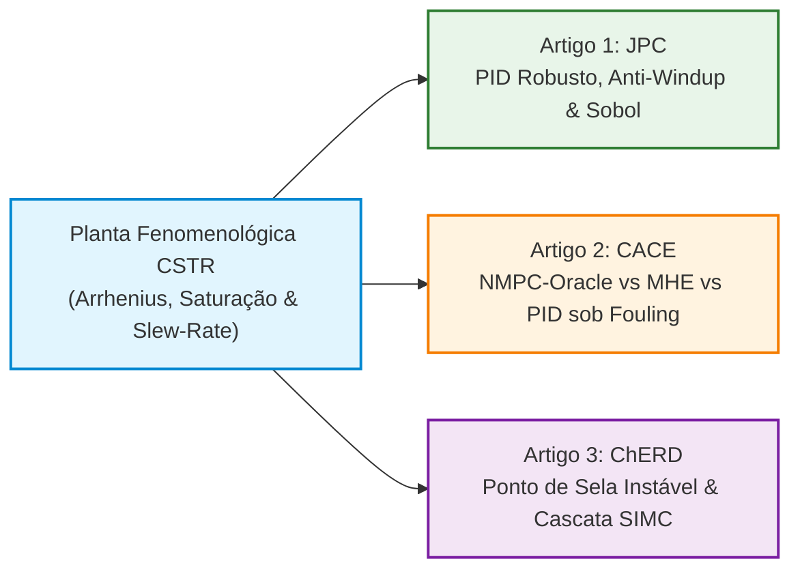

# IC — CSTR Control Benchmark: Nonlinear Modeling, Robust PID, NMPC & Cascade Control

> **Projeto de Iniciação Científica (PROIC)**  
> **Instituição:** Universidade Estadual de Santa Cruz (UESC) — Departamento de Ciências Exatas e Tecnológicas (DCET) — Colegiado de Engenharia Química  
> **Orientador:** Prof. Dr. Elilton Rodrigues Edwards  
> **Pesquisador Bolsista / Autor:** Gabriel Marques de Andrade  
> **Apoio e Financiamento:** FAPESB / CNPq (Edital 34/2026)  
> **Repositório Oficial:** [https://github.com/Marques-svnt/IC-CSTR-Control-Benchmark](https://github.com/Marques-svnt/IC-CSTR-Control-Benchmark)  
> **Status:** ✅ **Trilogia Elsevier Q1 (cas-dc) Finalizada & Código 100% Reprodutível**

[](https://www.python.org/)
[](https://github.com/astral-sh/ruff)
[](https://docs.pytest.org/)
[](LICENSE)
[](https://github.com/Marques-svnt/IC-CSTR-Control-Benchmark/releases/tag/v1.0.0-jpc-submission)

---

## 1. Sumário Executivo: A Trilogia de Artigos Elsevier

Este repositório abriga a infraestrutura computacional, modelos fenomenológicos, controladores e dados experimentais referentes aos **três artigos científicos independentes de alto impacto (Qualis A1 / Scopus Q1)** elaborados no padrão editorial de duas colunas da **Elsevier (`cas-dc.cls`)**:



### Artigo 1: *Journal of Process Control* (JPC)
* **Título:** *Robust PID Tuning under Actuator Saturation in Nonlinear Exothermic CSTRs: Performance, Anti-Windup and Sensitivity Trade-offs*
* **Diretório:** [`papers/01_journal_of_process_control/`](papers/01_journal_of_process_control/) (11 páginas em duas colunas)
* **Escopo:** Benchmark exaustivo de 8 sintonias PID (Ziegler-Nichols, Cohen-Coon, Tyreus-Luyben, AMIGO, 2-DOF AMIGO, Skogestad SIMC, Ótimo ITAE com $M_s \le 1.6$, 2-DOF Ótimo ITAE), mecanismo de anti-windup direcional sensível a *slew-rate*, 1200 simulações de Monte Carlo com ruído térmico e Análise de Sensibilidade Global de Sobol ($N=512$).

### Artigo 2: *Computers & Chemical Engineering* (CACE)
* **Título:** *When Does Nonlinear Model Predictive Control Outperform Robust PID? A Comparative Study under Fouling and Actuator Constraints*
* **Diretório:** [`papers/02_computers_chemical_engineering/`](papers/02_computers_chemical_engineering/) (10 páginas em duas colunas)
* **Escopo:** Comparativo rigoroso entre controle linear robusto (AMIGO e Ótimo ITAE) e controle preditivo não-linear baseado no solver CasADi/IPOPT (NMPC-Oracle com estado pleno vs. NMPC-MHE com horizonte móvel de estimação de estados e incrustação de camisa $\alpha_{UA}$). Demonstra que o NMPC apresenta ganho modesto de $2.3\%$ no caso nominal, mas supera o melhor PID em $21.0\%$ sob perda abrupta de troca térmica ($40\%$ de incrustação).

### Artigo 3: *Chemical Engineering Research and Design* (ChERD)
* **Título:** *Thermal Controllability Limits and Cascade Control in Exothermic CSTRs under Cooling Capacity Degradation*
* **Diretório:** [`papers/03_chemical_engineering_research_design/`](papers/03_chemical_engineering_research_design/) (10 páginas em duas colunas)
* **Escopo:** Operabilidade na janela intermediária metaestável de ponto de sela ($T = 345\text{ K}$, autovalor instável $\lambda_1 = +0.744\text{ min}^{-1}$), cinética contínua de incrustação $d(UA)/dt = -\kappa_{\text{foul}} r_A (UA - UA_{\min})$ e derivação analítica do tempo crítico até o descontrole térmico ($t_{\text{runaway}}$). Demonstra a estabilização por controle em cascata $T \to T_j \to q_j$ via Skogestad SIMC sequencial com compensação *feedforward* de utilidade.

---

## 2. Modelagem Fenomenológica do CSTR

```
           Alimentação de Carga
             (q, C_Af, T_f)
                   │
                   ▼
         ┌──────────────────┐
         │                  │ ◄── Camisa de Resfriamento
         │   Reator CSTR    │     (V_j, rho_j*cp_j)
         │    (V, rho*cp)   │
         │                  │ ──── Vazão de fluido refrigerante (q_j)
         │   A ───k(T)───> B│      Temperatura de entrada (T_jf)
         │                  │
         └─────────┬────────┘
                   │
                   ▼
            Corrente de Saída
              (q, C_A, T)
```

O sistema não-linear de três estados governa os balanços dinâmicos de massa e energia acoplados:

### 1. Balanço Material de Reagente ($C_A$)
$$\frac{d C_A(t)}{dt} = \frac{q}{V}\left(C_{Af} - C_A(t)\right) - r_A(C_A, T)$$
com cinética de Arrhenius de primeira ordem:
$$r_A(C_A, T) = k_0 \exp\left(-\frac{E}{R \cdot T(t)}\right) \cdot C_A(t)$$

### 2. Balanço de Energia no Reator ($T$)
$$\frac{d T(t)}{dt} = \frac{q}{V}(T_f - T(t)) + \frac{(-\Delta H)}{\rho c_p} r_A(C_A, T) - \frac{UA}{V \rho c_p}(T(t) - T_j(t))$$

### 3. Balanço de Energia na Camisa de Resfriamento ($T_j$)
$$\frac{d T_j(t)}{dt} = \frac{q_j(t)}{V_j}(T_{jf} - T_j(t)) + \frac{UA}{V_j \rho_j c_{pj}}(T(t) - T_j(t))$$

### 4. Dinâmica do Atuador de Válvula (Saturação & Taxa de Deslocamento)
A vazão manipulada $q_j(t)$ é restrita pelo envelope físico da válvula de resfriamento:
$$u_{\min} \le u(t) \le u_{\max}, \quad \left|\frac{du}{dt}\right| \le S_{\max}$$
onde $u_{\min} = 0.0\text{ L/min}$, $u_{\max} = 300.0\text{ L/min}$ e $S_{\max} = 80.0\text{ L/min}^2$.

---

## 3. Parâmetros Físicos e Ponto de Operação Nominal

| Parâmetro | Descrição | Valor | Unidade |
|---|---|---|---|
| $q$ | Vazão volumétrica da corrente de processo | $100.0$ | $\text{L/min}$ |
| $V$ | Volume da mistura reacional no reator | $100.0$ | $\text{L}$ |
| $k_0$ | Fator pré-exponencial de Arrhenius | $7.2 \times 10^{10}$ | $\text{min}^{-1}$ |
| $E/R$ | Energia de ativação normalizada | $8750.0$ | $\text{K}$ |
| $-\Delta H$ | Calor exotérmico da reação | $5.0 \times 10^{4}$ | $\text{cal/mol}$ |
| $\rho c_p$ | Capacidade calorífica volumétrica do reator | $500.0$ | $\text{cal/(L}\cdot\text{K)}$ |
| $UA$ | Coeficiente global de troca térmica $\times$ Área | $5.0 \times 10^{4}$ | $\text{cal/(min}\cdot\text{K)}$ |
| $V_j$ | Volume da camisa de resfriamento | $20.0$ | $\text{L}$ |
| $\rho_j c_{pj}$ | Capacidade calorífica volumétrica da camisa | $500.0$ | $\text{cal/(L}\cdot\text{K)}$ |
| $C_{Af}$ | Concentração de reagente na alimentação | $1.0$ | $\text{mol/L}$ |
| $T_f$ | Temperatura da corrente de alimentação | $350.0$ | $\text{K}$ |
| $T_{jf}$ | Temperatura do refrigerante de alimentação | $300.0$ | $\text{K}$ |

**Equilíbrio Nominal Estável ($\bar{q}_j = 100.0\text{ L/min}$):**
* $\bar{C}_A = 0.0502\text{ mol/L}$ (conversão $X_A = 94.98\%$)
* $\bar{T} = 396.65\text{ K}$
* $\bar{T}_j = 348.33\text{ K}$
* Autovalores contínuos: $\lambda = \{-1.571, -11.801, -13.269\}\text{ min}^{-1}$ (Localmente assintoticamente estável em malha aberta).

---

## 4. Arquitetura do Repositório (Monorepo Científico)

```
IC-CSTR-Control-Benchmark/
├── papers/                                   # Os 3 manuscritos completos no padrão Elsevier cas-dc
│   ├── 01_journal_of_process_control/         # Artigo 1 (JPC) — PID Robusto, Anti-Windup & Sobol
│   │   ├── main.tex, highlights.tex, references.bib
│   │   ├── sections/, figures/, tables/
│   │   ├── ready-to-overleaf/                 # Pasta autossuficiente para Overleaf
│   │   └── ready_to_overleaf.zip              # Pacote de 1 clique para upload
│   ├── 02_computers_chemical_engineering/     # Artigo 2 (CACE) — NMPC-Oracle vs MHE vs PID
│   │   └── (mesma estrutura modular + ready_to_overleaf.zip)
│   └── 03_chemical_engineering_research_design/ # Artigo 3 (ChERD) — Ponto de Sela & Cascata
│       └── (mesma estrutura modular + ready_to_overleaf.zip)
│
├── src/                                      # Single Source of Truth do código de engenharia
│   ├── sim_core/                              # Equações diferenciais, integrador RK45 e atuador
│   ├── classical_control/                     # Sintonias analíticas, PID industrial, cascata, Nelder-Mead
│   ├── controllers/optimal/                   # NMPC via CasADi/IPOPT e estimador MHE
│   ├── controllers/neural/                    # PINN surrogate, Neuro-PID e Neural ODE
│   └── evaluation/                            # Métricas IAE/ITAE/TV, Pareto e Sensibilidade de Sobol
│
├── experiments/                               # Scripts determinísticos de reprodução
│   ├── exp_01_classical_benchmark.py          # Benchmark nominal (Tabela 2 do Artigo 1)
│   ├── exp_01b_nmpc_oracle_comparison.py      # Benchmark NMPC vs PID (Tabela 7 do Artigo 2)
│   ├── exp_02_robustness_campaign.py          # Distúrbios de carga, fouling e ruído Monte Carlo
│   ├── exp_03_pareto_tuning_sweep.py          # Varredura contínua de Pareto (IAE vs TV)
│   ├── exp_04_neural_control_benchmark.py     # Comparativo avançado de controladores
│   ├── exp_05_cascade_benchmark.py            # Validação da estrutura em cascata
│   ├── exp_06_unstable_saddle_and_fouling.py  # Simulação de ponto de sela instável (Artigo 3)
│   └── build_paper_assets.py                  # Script unificado para regerar todos os assets
│
├── results/                                   # CSVs gerados numericamente e espelhos por periódico
│   ├── jpc/                                   # Espelhos de tabelas para o Artigo 1
│   ├── cace/                                  # Espelhos de tabelas para o Artigo 2
│   └── cherd/                                 # Espelhos de tabelas para o Artigo 3
│
├── tests/                                     # 125 testes automatizados (unitários, integração e property)
├── pyproject.toml                             # Metadados do projeto, dependências estritas e linters
└── README.md                                  # Este guia técnico
```

---

## 5. Guia de Instalação e Execução Rápida

### 1. Clonar o Repositório e Configurar Ambiente Virtual
```bash
# Clone via SSH (recomendado)
git clone git@github.com:Marques-svnt/IC-CSTR-Control-Benchmark.git
cd IC-CSTR-Control-Benchmark

# Criação do ambiente virtual com Python 3.12+
python3 -m venv .venv
source .venv/bin/activate

# Instalação das dependências em modo editável
pip install --upgrade pip
pip install -e ".[dev]"
```

### 2. Executar a Suíte de Testes Automatizados
```bash
pytest -q
```
*Critério de Sucesso Esperado:* **124 passed, 1 xfailed** (referente ao teste estrito de estabilidade do TL-PID com $M_s \approx 2.32$).

---

## 6. Receitas de Reprodução em 1 Comando (Reprodutibilidade Estrita)

### Reproduzir Artigo 1 (*Journal of Process Control*)
```bash
# Executa benchmark nominal e campanha de robustez
python experiments/exp_01_classical_benchmark.py
python experiments/exp_02_robustness_campaign.py
python experiments/exp_03_pareto_tuning_sweep.py
```

### Reproduzir Artigo 2 (*Computers & Chemical Engineering*)
```bash
# Executa NMPC-Oracle, estimador MHE e varredura de fouling
python experiments/exp_01b_nmpc_oracle_comparison.py
python experiments/exp_04_neural_control_benchmark.py
```

### Reproduzir Artigo 3 (*Chemical Engineering Research and Design*)
```bash
# Executa a dinâmica de ponto de sela instável e tempo de runaway sob fouling
python experiments/exp_06_unstable_saddle_and_fouling.py
```

### Regerar Todos os Assets e Tabelas dos 3 Artigos de Uma Só Vez:
```bash
python experiments/build_paper_assets.py
```

---

## 7. Como Fazer o Upload para o Overleaf

Cada subpasta em `papers/` contém um arquivo compactado autossuficiente (`ready_to_overleaf.zip`), pronto para compilação imediata sem dependências externas:

1. Acesse sua conta no [Overleaf](https://www.overleaf.com/).
2. Clique em **New Project** $\to$ **Upload Project**.
3. Selecione o arquivo zip desejado:
   * **Artigo 1 (JPC):** [`papers/01_journal_of_process_control/ready_to_overleaf.zip`](papers/01_journal_of_process_control/ready_to_overleaf.zip)
   * **Artigo 2 (CACE):** [`papers/02_computers_chemical_engineering/ready_to_overleaf.zip`](papers/02_computers_chemical_engineering/ready_to_overleaf.zip)
   * **Artigo 3 (ChERD):** [`papers/03_chemical_engineering_research_design/ready_to_overleaf.zip`](papers/03_chemical_engineering_research_design/ready_to_overleaf.zip)
4. O Overleaf compilará com motor `pdfLaTeX` nativo com **0 erros e numeração de páginas correta**.

---

## 8. Citação e Disponibilidade de Dados (Open Science)

Se você utilizar este código, modelo ou sintonias em sua pesquisa, por favor cite o release oficial do repositório:

```bibtex
@software{marques2026_cstr_benchmark,
  author       = {Gabriel Marques de Andrade and Elilton Rodrigues Edwards},
  title        = {{IC-CSTR-Control-Benchmark: Phenomenological CSTR Modeling, Robust PID, NMPC and Cascade Control Trilogy}},
  month        = oct,
  year         = 2026,
  publisher    = {GitHub},
  version      = {v1.0.0-jpc-submission},
  url          = {https://github.com/Marques-svnt/IC-CSTR-Control-Benchmark}
}
```

---

## 9. Licença e Agradecimentos

Este software é distribuído sob a licença [MIT](LICENSE).

A pesquisa é desenvolvida na **Universidade Estadual de Santa Cruz (UESC)**, Colegiado de Engenharia Química e Departamento de Ciências Exatas e Tecnológicas (DCET), financiada pelo Programa de Iniciação Científica (PROIC) com apoio da **FAPESB** e do **CNPq** (Edital 34/2026).
