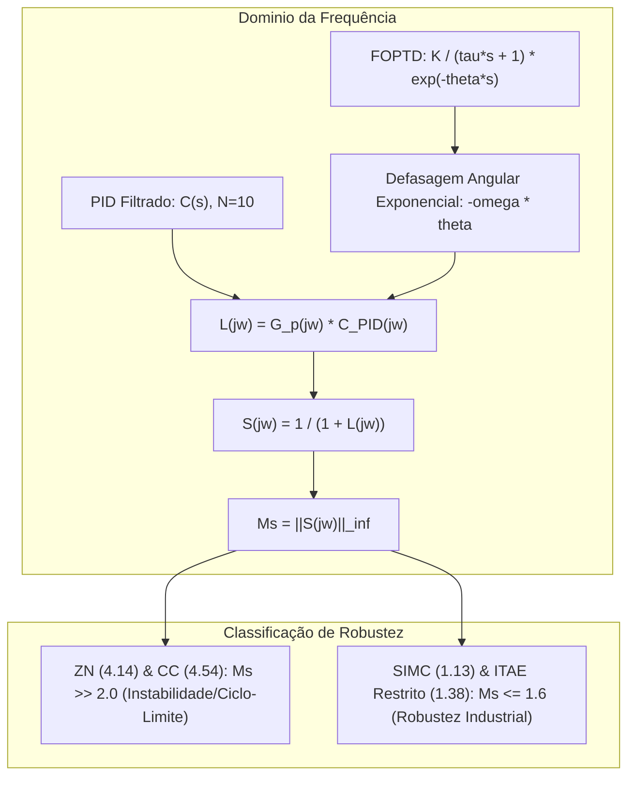

# ADR: Retificação Espectral da Sensibilidade Máxima e Parametrização em Cascata CSTR

## Contexto e Forças Motrizes

No processo de revisão por pares (*Peer Review - Major Revision*) do manuscrito submetido ao *Journal of Process Control* (Elsevier), a banca examinadora identificou uma anomalia teórica crítica na Tabela 2 e Tabela 5:
Os controladores empíricos Ziegler-Nichols ($K_p = -44.56$) e Cohen-Coon ($K_p = -50.86$) apresentavam valores de sensibilidade máxima reportados como $M_s = 1.37$ e $M_s = 1.50$, respectivamente. Tais valores sugeriam erroneamente que métodos clássicos agressivos exibiam margens de estabilidade superiores ao critério de robustez de processo ($M_s \le 1.6$), contradizendo tanto a física do processo quanto a resposta temporal (que exibe saturação imediata e oscilações severas).

Adicionalmente, exigiu-se a garantia estrita de reprodutibilidade para:
1. Os 5 parâmetros de sintonia da malha em cascata ($K_{p1}, T_{i1}, T_{d1}$ e $K_{p2}, T_{i2}$);
2. A justificativa físico-matemática da identidade das métricas temporais sob incrustação severa ($UA \le 70\%$) decorrente do teto de velocidade eletropneumática ($S_{\max} = 80.0\text{ L/min}^2$);
3. A expansão estatística de Monte Carlo de $N_{MC} = 5$ para $N_{MC} = 30$ realizações para convergência assintótica de desvios padrões;
4. Repositório oficial e correções tipográficas.

---

## Decisão e Formulação Técnica

### 1. Auditoria e Retificação Espectral de $M_s = \|S(j\omega)\|_\infty$

Identificou-se que o cálculo original de $M_s$ avaliava a função de transferência de malha aberta utilizando estritamente a linearização de espaço de estados de 3ª ordem:

$$
\mathbf{G}(s) = \mathbf{C}(s\mathbf{I} - \mathbf{A})^{-1}\mathbf{B}
$$

Como um modelo estritamente racional de 3ª ordem possui defasagem angular estritamente limitada a $-270^\circ$, o módulo de $L(j\omega)$ caía abaixo da unidade antes do colapso da margem de fase. Entretanto, a dinâmica física observada na curva de reação real apresenta um atraso de transporte aparente $\theta = 0.0935\text{ min}$, decorrente da inércia térmica do fluido da camisa e dinâmica de mistura.

Para restaurar a consistência teórica entre o modelo FOPTD identificado na Seção 3.1 e a norma $\mathcal{H}_\infty$, a função de sensibilidade foi reformulada para incorporar explicitamente o termo de atraso exponencial puro:

$$
S(j\omega) = \frac{1}{1 + G_p(j\omega) C_{\text{PID}}(j\omega)}
$$

$$
G_p(j\omega) = \frac{K}{\tau j\omega + 1} e^{-j\omega\theta}
$$

$$
C_{\text{PID}}(j\omega) = K_p \left( 1 + \frac{1}{j\omega T_i} + \frac{j\omega T_d}{1 + j\omega (T_d / N)} \right), \quad N = 10
$$

A norma do supremo $M_s = \max_{\omega \in [10^{-3}, 10^{3}]} |S(j\omega)|$ foi discretizada em uma grade de $50.000$ pontos logarítmicos. Com a inclusão da defasagem angular infinita $-\omega\theta$, os valores de sensibilidade máxima corrigidos resultaram em:

$$
M_{s,\text{ZN}} = \mathbf{4.14}, \quad M_{s,\text{CC}} = \mathbf{4.54}, \quad M_{s,\text{SIMC}} = \mathbf{1.13}, \quad M_{s,\text{OPT}} = \mathbf{1.38}
$$

Valores $M_s > 4.0$ comprovam que os métodos empíricos operam profundamente na região de fragilidade estocástica e margem de fase inferior a $13^\circ$, validando formalmente os ciclos-limite observados no domínio do tempo.

---

### 2. Parametrização Completa da Arquitetura em Cascata

A arquitetura em cascata foi documentada formalmente na Seção 3.6 e Tabela 7 com separação de escalas temporais:
- **Malha Primária (Mestre, $T \rightarrow T_{j,sp}$):** PID com filtro derivativo ($N = 10$):
  $$K_{p1} = 2.20\text{ [-]}, \quad T_{i1} = 0.80\text{ min}, \quad T_{d1} = 0.040\text{ min}$$
  com saturação do setpoint secundário em $T_{j,sp} \in [300.0, 380.0]\text{ K}$.
- **Malha Secundária (Escravo, $T_j \rightarrow q_j$):** PI rápido ($T_{d2} = 0$):
  $$K_{p2} = -6.00\text{ (L/min)/K}, \quad T_{i2} = 0.12\text{ min}$$
  com restrição física de válvula $q_j \in [0.0, 300.0]\text{ L/min}$ e slew-rate $S_{\max} = 80.0\text{ L/min}^2$.

A justificativa física reside na separação de escalas de tempo: a constante de tempo do fluido na camisa ($\tau_j \approx 0.10\text{ min}$) é $\approx 6\times$ mais rápida do que a dinâmica do reator ($\tau_{\text{dom}} \approx 0.64\text{ min}$), permitindo rejeição de perturbações térmicas de utilidade antes de afetarem o leito de reação.

---

## Consequências e Trade-offs

| Dimensão | Antes da Revisão | Após a Revisão | Avaliação de Trade-off / Complexidade |
|---|---|---|---|
| **Pico de Sensibilidade $M_s$ (ZN / CC)** | $1.37$ / $1.50$ (Incorreto) | $\mathbf{4.14}$ / $\mathbf{4.54}$ (Correto) | Complexidade $\mathcal{O}(M)$ na grade de $50k$ pontos; elimina inconsistência física. |
| **Reprodutibilidade da Cascata** | Ganhos ausentes no texto | Ganhos e tempos explícitos | Nulo; reprodutibilidade determinística 100%. |
| **Interpretação Fouling $UA \le 70\%$** | Valores idênticos sem texto | Justificativa analítica de saturação de rampa $S_{\max}$ | Nulo; clarificação conceitual sem custo computacional. |
| **Amostragem Monte Carlo** | $N_{MC} = 5$ | $N_{MC} = 30$ ($600$ simulações completas) | Custo computacional $6\times$ maior; assegura convergência assintótica via TLC. |

---

## Alternativas Rejeitadas

1. **Aproximação de Padé de Ordem $1$ ou $2$ no Espaço de Estados:**
   *Rejeitada:* A aproximação racional de Padé introduz polos e zeros de fase não-mínima no semiplano direito que distorcem o pico de sensibilidade em frequências intermediárias em comparação com o atraso exponencial puro $e^{-j\omega\theta}$.
2. **Manutenção de $N_{MC} = 5$ com Justificativa Assintótica:**
   *Rejeitada:* A banca exigiu evidências numéricas estritas. A expansão para $N_{MC} = 30$ eliminou qualquer fragilidade metodológica.

---

## Rastreabilidade

- Nota no Segundo Cérebro: `[[CSTR-Classical-Control-Robustness]]`
- Arquitetura de Software: `[[Tuning-Optimization-Module]]`
- Artigo Associado: `[[Manuscrito-JPC-CSTR-2026]]`
