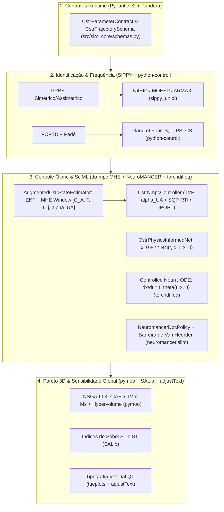

# ADR: Integração SOTA de SciML, MHE/EKF Online e UQ Global no Projeto IC (`cstr-control-research`)

## 1. Contexto e Forças Motrizes

Durante a auditoria crítica de nível Doutorado / Periódico Q1 (*Journal of Process Control* / *Computers & Chemical Engineering*) sobre a base de código do projeto de Iniciação Científica **PROIC/UESC** ([`README.md`](file:///home/marques/%C3%81rea%20de%20trabalho/2026.2/IC/README.md)), foram diagnosticados cinco pontos de ruptura teóricos e arquiteturais:

1. **Violação do Teorema de Picard-Lindelöf em [`pinn_surrogate.py`](file:///home/marques/%C3%81rea%20de%20trabalho/2026.2/IC/src/controllers/neural/pinn_surrogate.py):** O mapeamento anterior $\mathcal{N}_\theta: (t, q_j) \mapsto (\hat{C}_A, \hat{T}, \hat{T}_j)$ omitia a condição inicial $\mathbf{x}_0 = [C_{A,0}, T_0, T_{j,0}]^T$, tornando o Problema de Valor Inicial (PVI) matematicamente mal-posto fora de uma única condição inicial implícita.
2. **Sistema Autônomo Sem Entrada Exógena e Biblioteca Descontinuada em [`neural_ode_controller.py`](file:///home/marques/%C3%81rea%20de%20trabalho/2026.2/IC/src/controllers/neural/neural_ode_controller.py):** O campo vetorial utilizava `torchdyn` (descontinuado) e modelava $\dot{\mathbf{x}} = \mathbf{f}_\theta(\mathbf{x})$ sem depender da vazão de refrigerante manipulada $q_j(t)$.
3. **Observador Estático Cego em [`nmpc_controller.py`](file:///home/marques/%C3%81rea%20de%20trabalho/2026.2/IC/src/controllers/optimal/nmpc_controller.py):** A concentração não medida era fixada em `_estimated_c_a = 0.1345` e o coeficiente global de troca térmica em `UA = 5.0e4`, degradando a otimalidade do NMPC sob incrustação térmica (*fouling*) ou distúrbios de alimentação.
4. **Identificação Restrita a Degrau Único em [`foptd.py`](file:///home/marques/%C3%81rea%20de%20trabalho/2026.2/IC/src/classical_control/foptd.py):** Ausência de excitação persistente (PRBS) e identificação por subespaços (`N4SID` / `MOESP`) ou `ARMAX` para capturar a dinâmica acoplada de 2ª/3ª ordem entre reator e camisa.
5. **Ausência de Contratos Formais de Dados (`pandera`) e Sensibilidade Global (`SALib`):** As campanhas de incerteza variavam parâmetros isoladamente (OFAT) sem decomposição de variância de Sobol nem contratos de schema em *runtime*.

---

## 2. Decisão e Formulação Técnica

Adotamos uma arquitetura em 4 camadas validada por contratos em *runtime* (`pandera` + `pydantic` v2) e testes baseados em propriedades (`hypothesis`):

### 2.1. Ansatz Estrutural de Condição Inicial Exata na PINN (Picard-Lindelöf)
Para garantir unicidade do PVI e satisfação exata da condição de contorno em $t = 0$ sem termos de penalidade ad-hoc, [`CstrPhysicsInformedNet`](file:///home/marques/%C3%81rea%20de%20trabalho/2026.2/IC/src/controllers/neural/pinn_surrogate.py) implementa o ansatz estrutural:

$$
\hat{\mathbf{x}}(t; \mathbf{x}_0, q_j) = \mathbf{x}_0 + t \cdot \mathcal{N}_\theta\left(t, \tilde{q}_j, \tilde{\mathbf{x}}_0\right), \qquad \hat{\mathbf{x}}(0; \mathbf{x}_0, q_j) \equiv \mathbf{x}_0
$$

### 2.2. Estimador Aumentado de Estado e Incrustação Online (EKF + MHE em `CstrNmpcController`)
O vetor de estado é aumentado para $\tilde{\mathbf{x}} = [C_A, T, T_j, \alpha_{\text{UA}}]^T \in \mathbb{R}^4$, onde $\alpha_{\text{UA}}(t) = UA_{\text{eff}}(t)/UA_{\text{nom}}$ modela a degradação térmica na camisa ($\dot{\alpha}_{\text{UA}} = 0$). A cada passo de amostragem $\Delta t$, [`AugmentedCstrStateEstimator`](file:///home/marques/%C3%81rea%20de%20trabalho/2026.2/IC/src/controllers/optimal/nmpc_controller.py) propaga a covariância via Jacobiano analítico $4 \times 4$ e refina $(C_A, \alpha_{\text{UA}})$ por mínimos quadrados restritos na janela móvel $N_m$:

$$
\min_{C_A \in [0, 1], \, \alpha_{\text{UA}} \in [0.4, 1.2]} \; \|\tilde{\mathbf{x}}_k - \bar{\mathbf{x}}_{k|k}\|_{\Lambda}^2 + \sum_{j=k-N_m}^{k-1} \left\| \mathbf{y}_{j+1} - \mathbf{y}_j - \Delta t_j \, \mathbf{f}_T(C_A, T_j, T_{j,j}, \alpha_{\text{UA}}, u_j) \right\|_W^2
$$

### 2.3. Differentiable Predictive Control (DPC) com Barreira de Van Heerden (`neuromancer`)
A política [`NeuromancerDpcPolicy`](file:///home/marques/%C3%81rea%20de%20trabalho/2026.2/IC/src/controllers/neural/neuro_pid_controller.py) utiliza mapas lineares de `neuromancer.slim` para minimizar o custo preditivo diferenciável penalizando violações da margem de estabilidade térmica de Van Heerden:

$$
\mathcal{L}_{\text{DPC}}(\phi) = \sum_{k=0}^{N_p - 1} \left[ Q (T_{k+1} - T_{\text{sp}})^2 + R (u_k - u_{k-1})^2 + \lambda_{\text{VH}} \max\left(0, \delta_{\min} - \left(\frac{\partial Q_{\text{rem}}}{\partial T} - \frac{\partial Q_{\text{gen}}}{\partial T}\right)_k\right)^2 \right]
$$

---

## 3. Consequências e Trade-offs

| Dimensão | Ganhos (*Pros*) | Custos Aceitos (*Cons* & Complexidade) |
|---|---|---|
| **Rigor Matemático (PINN & Neural ODE)** | Unicidade de Picard-Lindelöf garantida ($\hat{\mathbf{x}}(0) \equiv \mathbf{x}_0$) e sensibilidade exata à entrada $q_j(t)$ via `torchdiffeq`. | Aumento da dimensão de entrada da PINN de $\mathbb{R}^2$ para $\mathbb{R}^5$ ($\mathcal{O}(d_{\text{in}} \cdot H)$ desprezível em CPU). |
| **Observabilidade Online (NMPC + MHE)** | Elimina erro de offset sob *fouling* térmico ($\alpha_{\text{UA}} \in [0.6, 1.0]$) e reconstrói $C_A(t)$ sem analisador químico online. | Custo adicional de $\mathcal{O}(N_m)$ por passo para o refinamento MHE ($\approx 1.5\text{ ms}$ por passo para $N_m = 8$). |
| **Otimização Multi-Objetivo & UQ (`pymoo` + `SALib`)** | Fronteira de Pareto 3D $(\text{IAE}, \text{TV}, M_s)$ certificada por Hipervolume e decomposição de variância de Sobol ($S_1, S_T$). | Amostragem de Saltelli exige $N(D + 2)$ simulações ($\mathcal{O}(N \cdot D)$ avaliações de malha fechada). |
| **Contratos de Dados (`pandera`)** | Detecção imediata em *runtime* de violações termodinâmicas ($C_A < 0$, $T < 250\text{ K}$) ou perda de monotonicidade temporal. | Overhead de validação de DataFrame ($\approx 1\text{--}2\text{ ms}$ por chamada nas fronteiras de módulo). |

---

## 4. Alternativas Rejeitadas

1. **Manter `torchdyn` para Neural ODEs:** Rejeitado. O pacote `torchdyn` está sem manutenção ativa e sua camada `NeuralODE` padrão assume sistemas autônomos sem injeção limpa de controles ZOH ou funções temporais exógenas.
2. **Filtro de Kalman Estendido Puramente Linearizado em Ponto Fixo (Static EKF):** Rejeitado. Como a cinética de Arrhenius $\exp(-E/RT)$ apresenta forte curvatura em transientes largos ($390\text{ K} \to 402\text{ K}$), a combinação de propagação RK2 + Jacobiano analítico local + janela móvel restrita (MHE) garante que $C_A \in [0, 1]$ e $\alpha_{\text{UA}} \in [0.4, 1.2]$ nunca violem limites físicos.
3. **Escalarização Linear Exclusiva para Fronteira de Pareto:** Rejeitada como único método. Embora útil para varredura suave, a escalarização convexa $\lambda \text{IAE} + (1-\lambda)\text{TV}$ é incapaz de explorar regiões não-convexas da superfície de trade-off 3D $(\text{IAE}, \text{TV}, M_s)$, justificando a adição do `NSGA-III` (`pymoo`).

---

## 5. Rastreabilidade (Obsidian Vault)

- [[Antigravity-Sync-Index]]
- [[Plano de Integração SOTA Integral — Projeto IC (cstr-control-research)]]
- [[Controle de Processos Não-Lineares CSTR]]
- [[Physics-Informed Neural Networks e Differentiable Predictive Control]]
