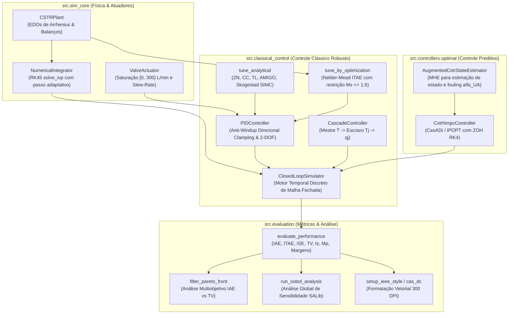

# Arquitetura do Pacote `src` — Simulação Fenomenológica e Controle Avançado

> **Documentação de Engenharia de Software e Modelagem Computacional**  
> Pacote modular de alta precisão para simulação não-linear do reator CSTR, controle clássico PID com anti-windup direcional, controle em cascata, controle preditivo não-linear (NMPC com MHE) e análise de sensibilidade global.

---

## 1. Visão Geral da Arquitetura

O pacote `src/` adota o padrão de **Módulos Profundos** (*Deep Modules*), expondo interfaces limpas e fortemente tipadas enquanto encapsula a complexidade matemática dos integradores numéricos e otimizadores não-lineares:



---

## 2. Estrutura dos Módulos

### 2.1 `src.sim_core` — Fenomenologia e Física da Planta
* **`cstr_plant.py`:** Equações diferenciais não-lineares acopladas de balanço de massa ($C_A$) e energia térmica ($T, T_j$) com cinética de Arrhenius de primeira ordem. Inclui cálculo analítico exato da matriz Jacobiana contínua ($A, B$), cálculo de pontos de equilíbrio via `scipy.optimize.root` e injeção de distúrbios em tempo real ($T_f, C_{Af}, T_{jf}, q, UA$).
* **`actuators.py`:** Modela a física real da válvula de resfriamento, impondo saturação de amplitude ($0 \le q_j \le 300\text{ L/min}$) e saturação de velocidade (*slew-rate* máximo de $80.0\text{ L/min}^2$). Fornece a flag booleana de saturação para o mecanismo de anti-windup.
* **`integrator.py`:** Integração de alta fidelidade via algoritmo de Dormand-Prince adaptativo (`RK45` do `scipy.integrate.solve_ivp`) com tolerâncias estritas ($rtol=10^{-6}, atol=10^{-8}$).
* **`schemas.py`:** Contratos de dados e validação de limites de estado físicos em tempo de execução via Pydantic v2.

### 2.2 `src.classical_control` — Controle Clássico e Cascata
* **`pid_controller.py`:** Implementação paralela com ação proporcional, integral trapezoidal e derivativa filtrada sobre a medição ($N=10$). Apresenta o algoritmo de **Clamping Anti-Windup Direcional**, que cobre saturação combinada de amplitude e velocidade da válvula:
  $$(u_{\text{raw}, k-1} - u_{\text{act}, k-1}) \cdot (K_p \cdot e_{\text{trap}}) > 0 \implies \text{congela integração}$$
  e ponderação de referência 2-DOF com parâmetros $\beta$ e $\gamma$.
* **`tuning_analytical.py`:** Sintonias analíticas para processos de ação reversa: Ziegler-Nichols, Cohen-Coon, Tyreus-Luyben, AMIGO, 2-DOF AMIGO e Skogestad SIMC.
* **`tuning_optimization.py`:** Sintonia ótima constrita minimizando ITAE com restrição dura de sensibilidade máxima $M_s \le 1.6$ via método simplex de Nelder-Mead.
* **`cascade_controller.py`:** Estrutura em cascata com malha escrava de temperatura de camisa ($T_j \to q_j$) e malha mestra de temperatura de reator ($T \to T_j$).
* **`closed_loop.py`:** Motor de simulação em malha fechada discreta com suporte a ruído térmico estocástico e perturbações de processo.

### 2.3 `src.controllers.optimal` — Controle Preditivo Não-Linear (NMPC)
* **`nmpc_controller.py`:**
  * **`CstrNmpcController`:** Formulação de controle preditivo em horizonte móvel não-linear implementado via **CasADi** com solver primal-dual **IPOPT**. Discretização exata por mapeamento Runge-Kutta de 4ª ordem (RK4) com 4 sub-passos por intervalo de controle.
  * **`AugmentedCstrStateEstimator`:** Estimador de estados baseado em horizonte móvel (MHE) com vetor de estado aumentado:
    $$\mathbf{x}_a = [C_A, T, T_j, \alpha_{UA}]^T$$
    onde $\alpha_{UA}$ é o fator de incrustação térmica da camisa estimado em tempo real a partir de medições de temperatura, operando com custos de chegada provenientes de um Filtro de Kalman Estendido (EKF).

### 2.4 `src.evaluation` — Métricas, Pareto e Sensibilidade Global
* **`metrics.py`:** Quadratura numérica rigorosa de $\text{IAE}$, $\text{ITAE}$, $\text{ISE}$, $\text{TV}$ (desgaste do atuador), sobressinal $M_p$, tempo de acomodação $t_s$ ($\pm 2\%$) e margens de sensibilidade em frequência $M_s$. Avalia $\text{IAE}$ contra o estado verdadeiro da planta ($T_{\text{true}}$) para evitar contaminação por ruído de medição.
* **`pareto.py`:** Algoritmo de filtragem de soluções não dominadas e detecção do ponto de joelho (*knee point*) na fronteira bi-objetivo $\text{IAE}$ vs. $\text{TV}$.
* **`sobol_sensitivity.py`:** Análise de Sensibilidade Global (GSA) baseada no algoritmo de Saltelli / Sobol via biblioteca `SALib`, computando índices de primeira ordem ($S_1$) e efeitos totais ($S_T$) para os parâmetros cinéticos e operacionais.
* **`plot_styles.py`:** Configuração global de estilo tipográfico vetorial para periódicos da Elsevier e IEEE Transactions ($300\text{ DPI}$, paletas acessíveis para daltônicos).

---

## 3. Exemplo de Uso Rápido via Código Python

```python
from src.sim_core.cstr_plant import CSTRPlant
from src.sim_core.actuators import ActuatorLimits
from src.classical_control.foptd import FOPTDModel
from src.classical_control.tuning_analytical import TuningRule, tune_analytical
from src.classical_control.pid_controller import PIDController, AntiWindupMethod
from src.classical_control.closed_loop import ClosedLoopSimulator

# 1. Inicializa planta e equilíbrio nominal
plant = CSTRPlant()
ss = plant.find_steady_state(q_j=100.0)

# 2. Sintonia Skogestad SIMC
foptd = FOPTDModel(k_p=-0.135, tau=0.380, theta=0.095)
gains = tune_analytical(foptd, rule=TuningRule.SKOGESTAD_SIMC_PID, tau_c=0.40)

# 3. Instancia controlador PID industrial com anti-windup direcional
limits = ActuatorLimits(u_min=0.0, u_max=300.0, max_slew_rate=80.0)
controller = PIDController(
    gains=gains,
    actuator_limits=limits,
    anti_windup=AntiWindupMethod.CLAMPING,
    u_bias=100.0
)

# 4. Simulação em malha fechada
sim = ClosedLoopSimulator()
res = sim.run(
    plant=plant,
    controller=controller,
    initial_state=ss,
    t_span=(0.0, 10.0),
    dt=0.02,
    setpoint_func=lambda t: ss.T - 2.0
)

print(f"Resultado SIMC: IAE = {res.metrics.iae:.3f} K*min, TV = {res.metrics.tv:.1f} L/min, Ms = {res.metrics.ms:.2f}")
```
